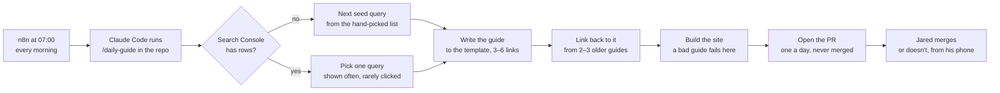

# The guide loop: the plan for getpickleballers.app

> **Status (2026-10-20):** the site is live; the loop is planned, not built. The plan copies Rasty Turek's Vaultaire growth loop onto this site: Claude wakes up every morning, finds the search queries the site is shown for but not clicked on, and writes one guide a day. This file is the site's own copy of the plan. The app-side half (the link bases, the decisions D-114 to D-116, how it sits beside the app's milestones) is `pickleball-app/docs/WEBSITE.md`, and the growth milestones G0 and G4 are tracked in `pickleball-app/docs/MARKETING.md`.

## Contents

1. [In one minute](#in-one-minute)
2. [What Rasty does, and what carries over](#what-rasty-does-and-what-carries-over)
3. [Where we are today](#where-we-are-today)
4. [The site](#the-site)
5. [The daily loop](#the-daily-loop)
6. [The guide template](#the-guide-template)
7. [The three phases and the seed queries](#the-three-phases-and-the-seed-queries)
8. [Setup only Jared can do](#setup-only-jared-can-do)
9. [Build order](#build-order)
10. [Open questions and later](#open-questions-and-later)

---

## In one minute

- **One domain, five jobs.** The landing page, the guides, the app's invite page (`/join`) and live score page (`/live`), and later universal links and the App Store banner.
- **The site is its own repo on GitHub Pages**, built with Astro. Guides are Markdown files with typed frontmatter, so a bad guide fails the build, not the site. It went live on 2026-10-20.
- **Claude Code is the worker, n8n is only the clock.** The loop needs the repo, file edits, git and a pull request; an LLM node inside n8n has none of those. n8n fires one scheduled command each morning.
- **Search Console is the signal**, read through Rasty's open-source tool, [gum](https://github.com/ehmo/gum): impressions, clicks and position per query. Keyword Planner comes later; it needs a Google Ads developer token.
- **Search Console is empty until there is traffic**, so phase one writes from a seed list of 23 queries the app can honestly answer ([`seo/seed-queries.md`](../seo/seed-queries.md)). Phase two switches on by itself when Search Console returns rows.
- **One guide a day, always as a PR.** The loop never merges. Jared reads it on his phone and merges, or doesn't. That is the quality bar.

---

## What Rasty does, and what carries over

Rasty Turek's photo-vault app, Vaultaire, gets most of its traffic from about 165 guides on its site, one written a day by Claude from Search Console data; he reported $41,000 in a month on the Starter Story interview. The loop: query Search Console for the last 28 days; find queries with many impressions, few clicks and a poor position; check volume in Keyword Planner; write one 1,500 to 2,000 word guide for the best one, with internal links and one call to action; link to it from existing guides so Google finds it within days; publish. He keeps the pace at one a day on purpose and keeps the writing good rather than bulk. His tool for all of it is gum, a Go command-line tool and MCP server over Google's APIs.

| His setup | Ours | Why the difference |
| :-- | :-- | :-- |
| iPhone photo vaults: a narrow niche with a few old incumbents | Pickleball: a wide, contested space with big rules sites and DUPR | We don't try to rank for *pickleball* or *pickleball rules*. The wedge is what the app does: side-out scoring, plus/minus rankings for a group, round robins, drop-in nights, scores on a TV |
| App on the App Store; about 10% of web visitors convert | No store page yet (no paid Developer Program) | The CTA is a waitlist; the pages age while the app finishes. SEO compounds over months, so starting now is the point |
| Search Console and Keyword Planner from day one | Search Console only, after a seed phase | Keyword Planner needs a Google Ads account and an approved developer token; impressions-but-no-clicks is the signal he actually acts on |
| Claude wakes up on a schedule (he doesn't say how) | n8n's Schedule Trigger on Jared's Mac, since it already runs there | n8n gives run history and a failure alert for free; `launchd` would do the same |
| Publishes straight to the site | Opens a PR | Jared reads one guide a day on his phone, which is the quality bar |
| Backlinks were his biggest lever; localisation his second (Japan is half his store traffic) | Neither yet | Both are the levers to pull if the seed guides get no impressions after three months |

---

## Where we are today

The site went live on 2026-10-20: the first deploy succeeded, DNS points at GitHub Pages, GitHub issued the certificate the next morning, and HTTPS is enforced. Every page answers at `https://getpickleballers.app`, and `www` redirects to it.

| Piece | State |
| :-- | :-- |
| Repo, Astro, GitHub Actions deploy | Done |
| Landing page, guides index, `/privacy/`, `/support/`, `/waitlist/` | Done |
| First guide: *How to Keep Score in Pickleball* | Done |
| `/join` and `/live`, restored unchanged from the app's history | Done; the live page shows *not set up yet* until the production Supabase project exists |
| Sitemap, `robots.txt`, `CNAME`, seed-query list | Done |
| DNS A records and `www` CNAME | Done (2026-10-19) |
| HTTPS certificate and Enforce HTTPS | Done (2026-10-20) |
| The other four seed guides | Not started |
| The two link bases in the app's `Base.xcconfig` pointed at the domain | Done (2026-10-20) |
| Waitlist form, support email, privacy page read-through | Not started |
| The `/daily-guide` skill and the n8n schedule (G4) | Not started |
| Search Console property and gum sign-in | Not started (Jared) |

---

## The site

Its own repo, built with Astro and published to GitHub Pages by `.github/workflows/deploy.yml` on every push to `main`. Pull requests get the build step only, so a broken guide fails the check instead of the site. The `.app` domain refuses plain HTTP in every browser, which is why the certificate step matters.

**Astro** writes a static site with no client JavaScript unless a page asks for it. Guides are a content collection (`src/content/guides/`): one Markdown file per guide with typed frontmatter in `src/content.config.ts`, so a missing field fails the build. The sitemap is generated. The look uses the app's own tokens (Ink, Chalk, Ball, Court Blue, Coral), light by default and dark with the system.

| Path | What | Note |
| :-- | :-- | :-- |
| `/` | The landing page: one line of what the app is, three moments, the Free/Pro sentence, the CTA | A demo group's live board joins it once the production Supabase project exists |
| `/guides/` and `/guides/<slug>/` | The index, newest first, and each guide | The loop writes here |
| `/join#<token>` | The app's invite page, byte for byte from the app's history (`public/join.html`) | The token after `#` never reaches a server |
| `/live#<token>` | The app's live score page for a TV or laptop (`public/live.html`) | Its Supabase address stays empty until production exists |
| `/privacy/`, `/support/` | What the app stores; how to reach Jared | The App Store needs both URLs |
| `/waitlist/` | The CTA's target until there is a store page | A hosted form (Tally) once it exists; a `waitlist` table in Supabase later |
| `robots.txt`, `sitemap-index.xml` | For Search Console | Generated; the two app pages are excluded |

No features section, compare pages or blog on day one. The guides carry the features in context, which is what ranks.

---

## The daily loop

Every morning one scheduled command runs Claude Code inside this repo with a one-word prompt, `/daily-guide`. A project skill file, `.claude/skills/daily-guide/SKILL.md`, holds the steps, the picking rule, the template and the voice, so the behaviour lives in a file Jared can read and edit, not in a prompt.



The decision is the only branch: Search Console rows when there are any, the seed list until then. Everything after it is the same every morning, and the loop ends at a pull request, never at the live site.

**The clock.** n8n on Jared's Mac: a Schedule Trigger at 07:00, then an Execute Command node running

```bash
cd "/Users/jared/Documents/GitHub/getpickleballers.app site" && claude -p "/daily-guide" --permission-mode acceptEdits
```

with a 30-minute timeout and the Mac kept awake. If n8n is ever retired, a `launchd` job with the same line replaces it. gum keeps its Google sign-in in the Mac's keychain, which is why the Mac is the simplest place to run it.

**The worker's steps.**

1. **Fresh start.** Fetch, and create a `web-guide-YYYY-MM-DD` branch from `main` in its own worktree, so the run never touches what Jared has open.
2. **Get the signal.** Phase one: the first unchecked query in `seo/seed-queries.md`. Phase two: `gum read searchconsole.searchanalytics.query` for the last 28 days with dimensions `query` and `page`, `rowLimit` 500, as JSON.
3. **Pick one query.** Impressions above 50 in 28 days, clicks under 2% of impressions, average position between 8 and 50, no guide already targeting it (frontmatter `query`) or written in the last 90 days, and on topic (scoring, rankings, organizing a group or a night, scores on a screen, the app's category). If the best row is an existing guide at position 8 to 20, improve that guide instead of writing a new one. Nothing qualifies: fall back to the seed list; that empty too: stop and say so.
4. **Write the guide** to the template, with 3 to 6 links to existing guides chosen by reading the index.
5. **Link back.** Add one sentence with a link to the new guide in the 2 or 3 existing guides closest to it. This is what gets a page indexed in days rather than weeks.
6. **Build and check.** `npm run build`; a broken link or missing frontmatter fails here, not on the site.
7. **Open the PR** with `gh pr create`: the query, why it was picked (the Search Console numbers, or "seed") and the guide's first paragraph. One PR a day, nothing merged by the loop.
8. **After a merge**, the next morning runs `gum write searchconsole.sitemaps.submit`, which nudges the crawl.

**What the loop never does.** Merge. Touch anything outside `src/content/guides/` and the seed list. Invent a rule of pickleball (USA Pickleball's rulebook and `pickleball-app/docs/SCORING_RULES.md` are the sources). Describe a feature the app doesn't have (`pickleball-app/docs/BUILD_STATUS.md` says what's built). Publish more than one guide a day, even when several queries qualify.

**Once a month, by hand:** read clicks and impressions per guide. Three months in, if the seed guides have impressions, phase two is already running. If none has, the site has a reach problem the loop can't fix, and the answer is backlinks: r/Pickleball, the league's venue, directories, a build-in-public post.

---

## The guide template

Every guide is 1,200 to 2,000 words in the same shape, so the loop's output is predictable and Jared can read one on his phone in five minutes.

```yaml
title: "How to Keep Score in Pickleball (Doubles and Singles)"
description: "The three-number call, who serves next, side outs and win by 2, in plain words, with a worked game."
query: "how to keep score in pickleball"
publishDate: 2026-10-19
tags: [scoring]
```

1. **The answer in the first two sentences.** No preamble, no "in this guide we'll".
2. **H2 sections** that each answer the question a reader would ask next. A step list where there are steps. One table where things compare.
3. **One example from a real game**, scored the way the app scores it (*4-2-1*: your points, their points, which server).
4. **FAQ:** four to six H3 questions in the words people type, two or three sentences each.
5. **The bottom line:** three sentences.
6. **One call to action**, after the bottom line and nowhere else: the layout adds `<AppCta />`, one line on what the app does for exactly this problem, and the waitlist button (the App Store button once `APP_STORE_URL` is set).
7. **Links:** 3 to 6 to other guides, in sentences where a reader would want them; none to the landing page beyond the CTA.

Tags come from a fixed set: `scoring`, `rankings`, `organizing`, `apps`. The voice is the app's (`pickleball-app/docs/DESIGN.md`): short sentences, plain words, no exclamation marks, light pickleball language, nothing the app doesn't do. Titles are a "How to" or a question; the slug is the query without stop words. The first guide, [How to Keep Score in Pickleball](https://getpickleballers.app/guides/how-to-keep-score-in-pickleball/), is the model.

---

## The three phases and the seed queries

| Phase | Source | Starts when | Ends when |
| :-- | :-- | :-- | :-- |
| 1. Seed list | 23 hand-picked queries in `seo/seed-queries.md`, one ticked per morning | Now | Search Console returns rows for the site |
| 2. Search Console | Queries with impressions, few clicks and a poor position, through gum | The first morning step 2 finds rows, usually a few months in | Never; this is the steady state |
| 3. Keyword Planner | Volume for queries the site has no impressions for yet | A Google Ads account and developer token exist | Never; it adds to phase 2 |

The seed list itself, with its tick boxes, is [`seo/seed-queries.md`](../seo/seed-queries.md): scoring and rules first, because the app enforces them and they're the least contested; rankings next; organizing a group or a night; and the app's own category last, since those pages only make sense once there is something to download. The first five are written by hand before the loop starts, so the first guide has siblings and the loop has pages to link from.

---

## Setup only Jared can do

Each needs Jared's accounts, and each is a few minutes.

- [x] **DNS at the registrar:** four `A` records on the apex to GitHub Pages' addresses (`185.199.108.153`, `.109.153`, `.110.153`, `.111.153`) and a `CNAME` for `www` to `basispoint3.github.io`. Done 2026-10-19.
- [x] **GitHub Pages settings:** source *GitHub Actions*, custom domain `getpickleballers.app`. Done 2026-10-19.
- [x] **Enforce HTTPS** on the Pages settings page once the certificate is issued. Done 2026-10-20.
- [ ] **Search Console:** add `getpickleballers.app` as a domain property, verify with the DNS TXT record it gives, submit `https://getpickleballers.app/sitemap-index.xml` once.
- [ ] **Google Cloud project** with the Search Console API enabled, an OAuth consent screen (External, testing, Jared's account as a test user) and a Desktop app OAuth client. Then on the Mac: `brew install ehmo/tap/gum`, register the client with `gum auth use-oauth-client --client-id … --secret-stdin`, `gum login --service searchconsole`, and `gum read searchconsole.sites.list` to check. Unblocks phase two, not phase one.
- [ ] **The waitlist form** at Tally (free), one email field, its embed address into `WAITLIST_FORM_URL` in `src/consts.ts`.
- [ ] **A support email address**, into `SUPPORT_EMAIL` in the same file.
- [ ] **n8n:** the Schedule Trigger and Execute Command workflow above, turned on after the first PR has been read.
- [ ] **Later:** a Google Ads account and a developer token (`gum auth use-ads-developer-token`) for phase three.

---

## Build order

Two growth milestones, each ending with a stop for Jared to try it. Neither touches the iOS app.

**G0, the site: mostly done.** What remains:

1. ~~HTTPS enforced and the domain opening in a browser.~~ Done 2026-10-20.
2. The next four seed guides, written by hand to the template and cross-linked.
3. ~~The two link bases in the app's `Base.xcconfig` pointed at `https://getpickleballers.app/join` and `/live`.~~ Done 2026-10-20.
4. The waitlist form, the support email and a read-through of the privacy page.

Done when: an invite link from the app opens `/join` over HTTPS, five guides are in the sitemap, and Search Console has accepted it.

**G4, the loop: about half a day.**

1. The `/daily-guide` skill file and a dry run by hand: one `claude -p "/daily-guide"`, then read the PR it opens.
2. The n8n workflow, turned on after that first PR has been read. Three mornings, three PRs, then it's routine.
3. Phase two switches on by itself the first morning Search Console returns rows; read that PR's reasoning closely.

Done when: three consecutive mornings have each produced one PR Jared would merge without edits.

---

## Open questions and later

**Open for Jared.**

1. **The clock:** n8n as proposed, or `launchd`, so the loop has no dependency on n8n being up?
2. **07:00 and standing permission:** is the hour right, and is the loop allowed to commit and push on `web-guide-*` branches without asking? It still never merges.
3. **The waitlist's home:** a Tally form now, or a `waitlist` table in Supabase once the production project exists?
4. **The next four guides:** the four at the top of the seed list, or Jared's own pick?

**Later, in rough order.**

- The demo group's live board as a section of the landing page, once the production Supabase project exists.
- Keyword Planner through gum, once there is a Google Ads account.
- Universal links (`public/.well-known/apple-app-site-association`) and the App Store smart banner, when the Developer Program and the store page exist; the invite page then opens the store when the app isn't installed.
- The call to action becomes the App Store link everywhere at once, by setting `APP_STORE_URL`.
- Translations of the guides, Rasty's second-biggest lever, if a non-English market shows up in Search Console.
- Feature and compare pages, if the guides' internal links want somewhere to point.
- **More loops on the same worker**, picked by Jared on 2026-10-20 and tracked as G5 to G8 in `pickleball-app/docs/MARKETING.md`: reply drafting for Reddit and Facebook threads that ask the seed questions (drafts into a digest, never posted by the loop), weekly backlink prospecting into Gmail drafts, a monthly guide refresh and internal-link repair, and the App Store review and keyword watch once there is a store page. Each is a different picking rule and output on the same `/daily-guide` worker, so they come after G4 is routine.
